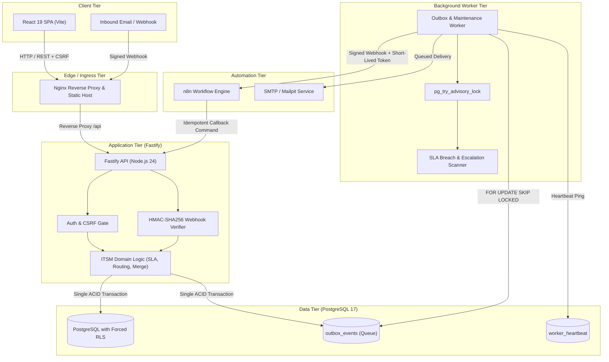
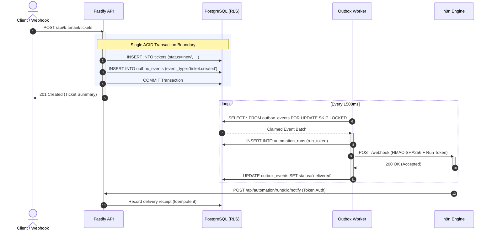
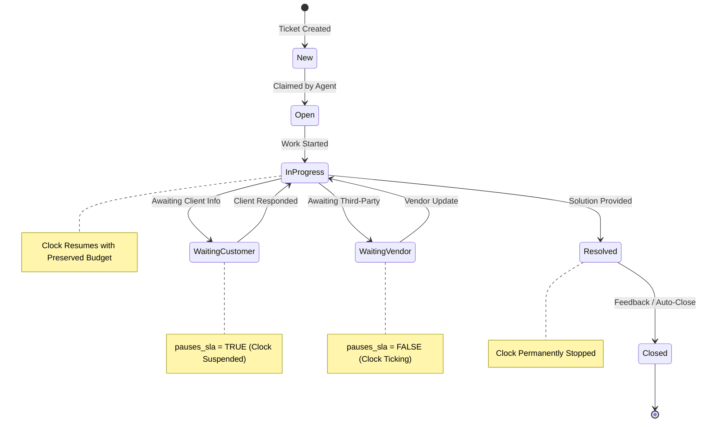

# OpsPilot

Multi-tenant IT Service Desk and operational automation platform engineered with Fastify, React 19, PostgreSQL Row-Level Security (RLS), and self-hosted n8n workflow orchestration.

OpsPilot is designed as a production-grade service desk architecture demonstrating robust distributed systems patterns: database-enforced multi-tenancy, transactional outbox messaging with at-least-once delivery, deterministic business-hours SLA calculations, optimistic concurrency control, and defensive security hardening.

---

## Executive Summary & Core Capabilities

- **Database-Enforced Multi-Tenancy**: Forced Row-Level Security (RLS) on PostgreSQL, composite tenant foreign keys, and non-owner application roles. Cross-tenant leakage is prevented at the database kernel level.
- **Transactional Outbox Engine**: Atomic database writes paired with asynchronous queue dispatching using PostgreSQL `FOR UPDATE SKIP LOCKED`, exponential backoff, dead-lettering, and graceful event skipping.
- **Deterministic SLA Calculation**: Timezone-aware business hours, tenant holiday calendars, status-driven clock pauses (e.g., waiting on customer vs. waiting on vendor), and dynamic SLA recalculation on priority or category shifts.
- **Automated Escalation Policies**: Configurable threshold-based escalations targeting managers, team leads, or escalation queues with deduplicated atomic dispatch receipts.
- **Defensive Security Architecture**: Double-submit session-bound CSRF protection, HMAC-SHA256 signed inbound webhook processing with replay window enforcement, non-blocking asynchronous scrypt hashing, and automated brute-force account lockout.
- **Lossless Ticket Merging**: Multi-participant tracking, zero-loss attachment migration with database bytea blob persistence, and non-intrusive internal audit notes that preserve first-response SLA metrics.
- **Production Observability**: Native Prometheus metrics endpoint (`/api/metrics`), worker liveness heartbeats, correlation ID propagation across all logs, and health check probes.

---

## Architecture Overview



---

## Architectural Decisions & Engineering Designs

### 1. True Multi-Tenancy via PostgreSQL Row-Level Security (RLS)

- **Context**: In multi-tenant systems, software-level filtering (`WHERE tenant_id = $1`) frequently suffers from developer error, ORM leakage, or missing joins, creating catastrophic cross-tenant data exposure.
- **Decision**: 
  - OpsPilot enforces multi-tenancy at the database layer via PostgreSQL `FORCE ROW LEVEL SECURITY`.
  - The API connects using a non-owner database role (`opspilot_app`) that strictly lacks the `BYPASSRLS` attribute.
  - Every transaction sets session-scoped context variables (`SET LOCAL app.tenant_id = ...; SET LOCAL app.user_id = ...`).
  - Tables utilize composite foreign keys `(tenant_id, id)` and foreign key references that include `tenant_id`. Any query attempting to access a record belonging to another workspace is rejected by the database engine regardless of API parameters.

```sql
-- Architectural enforcement in PostgreSQL
ALTER TABLE tickets ENABLE ROW LEVEL SECURITY;
ALTER TABLE tickets FORCE ROW LEVEL SECURITY;

CREATE POLICY tenant_isolation_policy ON tickets
  FOR ALL
  TO opspilot_app
  USING (tenant_id = NULLIF(current_setting('app.tenant_id', true), '')::uuid);
```

### 2. Transactional Outbox Pattern with Concurrency-Safe Dispatch

- **Context**: State mutations (such as ticket creation) and external side-effects (notifying n8n, sending emails) cannot participate in a single distributed ACID transaction without introducing latency and dual-write failures.
- **Decision**: 
  - All side effects are written to an `outbox_events` table inside the exact same database transaction that creates or mutates the ticket.
  - A dedicated background worker continuously polls pending events using `SELECT ... FOR UPDATE SKIP LOCKED`. This guarantees zero row-lock contention across concurrent worker instances.
  - If n8n or outbound SMTP is temporarily unavailable, outbox events execute exponential backoff up to 5 attempts before transitioning to `dead`.
  - Unhandled event types are transitioned to `skipped` with audit logs, preventing poison pill blocks without false delivery reporting.



### 3. Contractual SLA Engine with Business Calendars & Status Pauses

- **Context**: Enterprise ITSM SLAs are legal commitments, not simple clock deltas. Calculating resolution deadlines requires honoring tenant timezones, weekly shift schedules, national holidays, and status pauses.
- **Decision**:
  - `packages/core` provides pure date/time mathematics using IANA timezone conversion.
  - **Holiday Schedules**: Supported via `tenant_holidays`, preventing deadlines from advancing over public or company holidays.
  - **Granular Status Pauses**: `ticket_statuses.pauses_sla` allows administrators to configure which stages suspend SLA clocks. For example, `Waiting on Customer` pauses the clock, whereas `Waiting on Vendor` keeps the resolution clock running.
  - **Dynamic Target Recalculation**: When a ticket's category or priority is updated, `shiftedSlaDue` preserves the exact business minutes already consumed and computes the remaining window under the new policy.



### 4. Enterprise Security Hardening

- **Session-Bound CSRF Tokens**: Because cross-site deployments between web app and API origins require `SameSite=None` session cookies, Fastify issues a per-session CSRF token at login and returns it from `GET /auth/me`. The web app echoes it in `x-csrf-token` on every mutating verb (`POST`, `PUT`, `PATCH`, `DELETE`), and the API compares it against the token stored on the session row in PostgreSQL.
- **HMAC-SHA256 Inbound Webhook Signing**: Inbound email webhooks require an `x-opspilot-timestamp` and `x-opspilot-signature`. Signatures are computed over `<timestamp>.<raw body bytes>`, so the timestamp cannot be swapped. Replay attacks are blocked by enforcing an adjustable 5-minute skew window (`INBOUND_WEBHOOK_TOLERANCE_SECONDS`).
- **Timing-Safe Asynchronous Password Security**: Uses Node.js asynchronous `scrypt` hashing with unique salts, eliminating event loop blocking under authentication bursts. Unknown accounts are verified against a synthetic `DUMMY_HASH` to eliminate response latency discrepancies and prevent user enumeration. Accounts automatically lock for 15 minutes upon 5 consecutive failed attempts.
- **Cluster-Safe Advisory Locks**: Clustered worker instances synchronize maintenance cycles (SLA breach detection, escalations, credential purging) via PostgreSQL session advisory locks (`pg_try_advisory_lock`), eliminating race conditions without requiring an external Redis cluster.

### 5. Accelerated Substring Search via Trigram Indexes (pg_trgm)

- **Context**: Standard full-text search (`tsvector`) fails on leading wildcards and partial word fragments (e.g. searching "disc" will not match "disconnect", and searching ticket numbers or user email fragments fails). Naive `ILIKE '%term%'` degrades to full sequential table scans at scale.
- **Decision**: Enabled the PostgreSQL `pg_trgm` extension and replaced the unused tsvector index with GIN trigram indexes (`gin_trgm_ops`) on `tickets.subject`, `coalesce(tickets.description, '')`, and `users.display_name`. PostgreSQL's query optimizer executes fast bitmap index scans for wildcard queries without sequential table scans.

### 6. Multi-Tiered Frontend Error Boundaries

- **Context**: In React applications, unhandled JavaScript errors in any leaf component propagate to the root, unmounting the entire component tree and presenting a blank screen.
- **Decision**: Implemented two-tiered `ErrorBoundary` isolation in [`apps/web/src/components.tsx`](file:///Users/tom/Desktop/projects/ops-pilot/apps/web/src/components.tsx) and [`apps/web/src/App.tsx`](file:///Users/tom/Desktop/projects/ops-pilot/apps/web/src/App.tsx). View-level boundaries isolate failures inside `<Outlet />`, ensuring topbar navigation, sidebar controls, and the multi-tenant workspace switcher remain fully interactive even if an individual view encounters an unexpected runtime error.

---

## Technology Stack

| Layer | Component | Technical Justification |
|---|---|---|
| **Monorepo** | pnpm workspaces | Type-safe shared code between API, UI, and database packages. |
| **Backend API** | Node.js 24 + Fastify | High-throughput asynchronous HTTP processing with schema-validated hooks. |
| **Validation** | Zod | Single source of truth for runtime validation and static TypeScript inference. |
| **Frontend** | React 19 + Vite | Component-driven administrative UI, lightweight state management, zero bundle bloat. |
| **Database** | PostgreSQL 17 | Advanced ACID primitives: forced RLS, composite foreign keys, advisory locks, bytea blob storage. |
| **Automation** | n8n Community Edition | Extensible workflow orchestration executing outside the core transaction boundary. |
| **Integration Testing** | Testcontainers | Real PostgreSQL instances instantiated in Docker during automated test execution. |

---

## Monorepo Layout

```
ops-pilot/
├── apps/
│   ├── api/             # Fastify REST service, domain services, and worker daemon
│   └── web/             # React 19 SPA, workspace consoles, reports, and admin panels
├── packages/
│   ├── core/            # Domain math (SLA, business hours, routing matcher, scrypt)
│   └── db/              # SQL migrations, app role definition, and seed fixtures
├── deploy/
│   ├── n8n/             # Preconfigured workflow automation templates
│   ├── nginx.conf       # Reverse proxy template and security header definitions
│   ├── backup.sh        # Automated database backup script with 14-day retention
│   └── restore.sh       # Database restoration harness
├── compose.yaml         # Local multi-service development orchestration
└── package.json         # Workspace root configuration
```

---

## API Reference

### Authentication & Account Security

| Method | Path | Description | Access |
|---|---|---|---|
| `POST` | `/api/auth/login` | Session login with CSRF token generation and lockout tracking | Public |
| `POST` | `/api/auth/logout` | Revokes current session and clears cookies | Authenticated |
| `GET` | `/api/auth/me` | Current user profile, active memberships, and CSRF token | Authenticated |
| `GET` | `/api/auth/sessions` | Lists active sessions with device and IP metadata | Authenticated |
| `DELETE` | `/api/auth/sessions/:id` | Revokes a specific active session | Authenticated |
| `POST` | `/api/auth/password/change` | Updates password with session re-hashing (CSRF protected) | Authenticated |
| `POST` | `/api/auth/password/reset/request` | Queues single-use password reset token | Public |
| `POST` | `/api/auth/password/reset/confirm` | Consumes reset token and sets new password | Public |

### Service Desk Operations

| Method | Path | Description | Access |
|---|---|---|---|
| `GET` | `/api/t/:tenantSlug/tickets` | Filtered, role-scoped ticket queue with SLA deadline sorting | Workspace Member |
| `POST` | `/api/t/:tenantSlug/tickets` | Creates a ticket; auto-assigns category priority & routes team | Workspace Member |
| `GET` | `/api/t/:tenantSlug/tickets/:id` | Detailed ticket view with comments, SLA badges, and timeline | Participant / Team |
| `POST` | `/api/t/:tenantSlug/tickets/:id/claim` | Optimistically claims an unassigned ticket into `open` | Agent / Admin |
| `POST` | `/api/t/:tenantSlug/tickets/:id/assign` | Reassigns ticket to a specific team or agent | Agent / Admin |
| `POST` | `/api/t/:tenantSlug/tickets/:id/comments` | Adds internal notes, acknowledgements, or SLA first responses | Participant / Team |
| `POST` | `/api/t/:tenantSlug/tickets/:id/merge` | Merges secondary ticket; transfers files and participants | Agent / Admin |
| `POST` | `/api/t/:tenantSlug/inbound/email` | HMAC-SHA256 signed inbound email ingestion webhook | Webhook Secret |

### Administration & Observability

| Method | Path | Description | Access |
|---|---|---|---|
| `GET` | `/api/t/:tenantSlug/config` | Retrieves teams, categories, priorities, rules, and SLA settings | Workspace Member |
| `POST` | `/api/t/:tenantSlug/holidays` | Configures tenant calendar holidays for SLA calculations | Tenant Admin |
| `POST` | `/api/t/:tenantSlug/escalation-policies` | Configures SLA warning/breach escalation policies | Tenant Admin |
| `GET` | `/api/t/:tenantSlug/reports` | SLA compliance (met, breached, running), CSAT, and volumes | Agent / Admin |
| `GET` | `/api/metrics` | Prometheus metrics endpoint (queues, liveness, breaches) | Bearer Token |
| `GET` | `/api/health` | PostgreSQL database readiness probe | Public |
| `GET` | `/api/health/live` | Process liveness probe | Public |

---

## Local Development Quickstart

### Prerequisites

- Node.js 24+ and Corepack enabled
- PostgreSQL 17 (or use Docker Compose)
- pnpm 9+

### Manual Setup

```bash
# 1. Clone repository and install dependencies
corepack enable
pnpm install

# 2. Configure environment
cp .env.example .env

# 3. Provision database and run migrations
createdb opspilot
pnpm db:role
pnpm db:migrate
pnpm db:seed

# 4. Run API and Web servers concurrently
pnpm dev:api
pnpm dev:web
```

- API Server: `http://localhost:3000`
- Web Application: `http://localhost:5173`

---

## Docker Compose Orchestration

The full OpsPilot stack can be run locally using Docker Compose:

```bash
docker compose up --build
```

### Service Map

- **Web Application**: `http://localhost:8080`
- **Fastify API**: `http://localhost:3000`
- **n8n Automation Engine**: `http://localhost:5678`
- **PostgreSQL Database**: `localhost:5433`

The one-shot `bootstrap` container automatically verifies role privileges, runs migrations `001` through `029`, and seeds demo data.

### Seed Accounts (Password: `Passw0rd!`)

| Workspace | Email | Role | Scope |
|---|---|---|---|
| **Acme Corp** | `admin@acme.test` | `tenant_admin` | Full workspace administration |
| **Acme Corp** | `agent@acme.test` | `agent` | Ticket queues, claims, responses |
| **Acme Corp** | `employee@acme.test` | `employee` | Self-service portal requester |
| **Globex** | `admin@globex.test` | `tenant_admin` | Isolated secondary tenant |
| **Platform** | `platform@opspilot.test` | `platform_admin` | Multi-tenant provisioning |

---

## Automated Verification & Testing

OpsPilot maintains comprehensive test coverage across both unit math and full database integration flows:

```bash
# Run unit tests (SLA business calculations, routing matcher, scrypt)
pnpm --filter @opspilot/core test

# Run integration tests (PostgreSQL Testcontainers, RLS validation, CSRF, Merging)
pnpm --filter @opspilot/api test

# Monorepo typechecking
pnpm -r typecheck
```

---

## License & Attribution

Developed by Oak Soe Thein as a showcase of modern multi-tenant software architecture and resilient automation patterns. Distributed under the MIT License.
